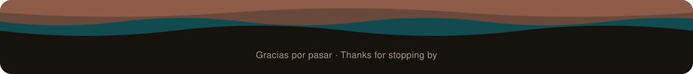

<picture>
  <source media="(prefers-color-scheme: dark)" srcset="https://readme-typing-svg.demolab.com?font=Fira+Code&weight=500&size=21&duration=3200&pause=1100&color=E8876B&center=true&vCenter=true&width=640&height=48&lines=Hago+apps+web%2C+de+escritorio+y+Android;I+build+web%2C+desktop+%26+Android+apps;React+%C2%B7+Node.js+%C2%B7+Supabase+%C2%B7+IA;Creador+de+EloDiff+%E2%86%92+elodiff.app" />
  
</picture>

&nbsp;
&nbsp;

### 👋 Sobre mí

- 💼 Trabajé en **Viupik** (España, visualización arquitectónica 3D) con React, Node.js y MongoDB.
- 🔭 Estoy construyendo **[EloDiff](https://elodiff.app)**, un coach de League of Legends con IA (web + Windows).
- 📱 También hago apps Android con **Capacitor** y herramientas en **Python**.
- 🌱 Aprendiendo **TypeScript**, **Next.js** y **Angular**.
- 🎓 Licenciatura en Programación en **UCES** · Full Stack en Digital House y Coderhouse.
- 🤝 Abierto a trabajo y proyectos freelance.

🌎 <b>English</b>

 

- 💼 Worked at **Viupik** (Spain, 3D architectural visualization) with React, Node.js and MongoDB.
- 🔭 Building **[EloDiff](https://elodiff.app)**, an AI League of Legends coach (web + Windows).
- 📱 I also build Android apps with **Capacitor** and tools in **Python**.
- 🌱 Learning **TypeScript**, **Next.js** and **Angular**.
- 🎓 Bachelor's in Programming at **UCES** · Full Stack bootcamps at Digital House and Coderhouse.
- 🤝 Open to jobs and freelance projects.

### 🛠️ Stack

  
   
  

### 🚀 Proyectos · Projects

  
  
  
  
  
  

  Más en mi <a href="https://portfolio-joaquin-orlandau-rosso.vercel.app/">portfolio</a>: <b>Ruleta Gamer</b> (Python + Twitch EventSub), <b>Twitch Clips AI</b> (Gemini) y el <a href="https://portafolio-danel-nine.vercel.app/">portfolio de Danel</a>.

 

  <picture>
    <source media="(prefers-color-scheme: dark)" srcset="https://raw.githubusercontent.com/Joaquin-Orlandau-Rosso/Joaquin-Orlandau-Rosso/output/snake-dark.svg" />
    <source media="(prefers-color-scheme: light)" srcset="https://raw.githubusercontent.com/Joaquin-Orlandau-Rosso/Joaquin-Orlandau-Rosso/output/snake-light.svg" />
    
  </picture>

